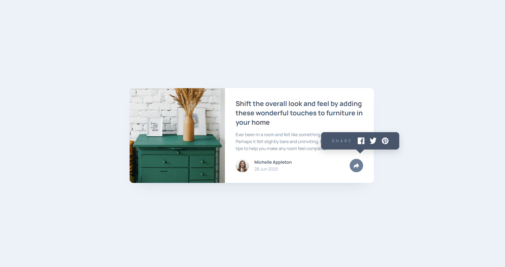
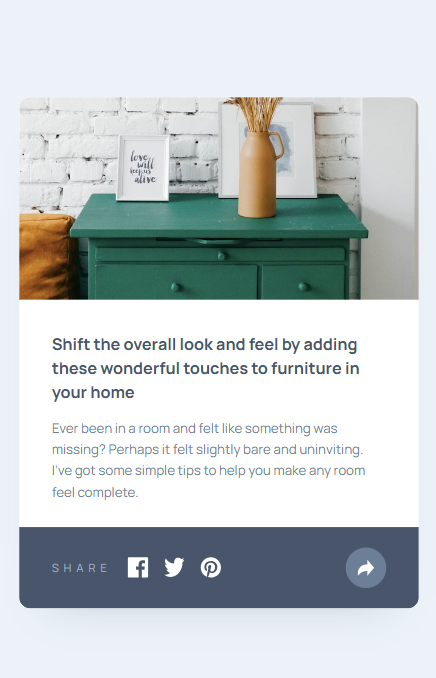

# Frontend Mentor - Article Preview Component Solution

This is my solution to the [Article Preview Component challenge on Frontend Mentor](https://www.frontendmentor.io/challenges/article-preview-component-dYBN_pYFT). Frontend Mentor challenges help improve coding skills by building realistic projects.

## Table of Contents

- [Overview](#overview)
  - [The Challenge](#the-challenge)
  - [Screenshot](#screenshot)
  - [Links](#links)
- [My Process](#my-process)
  - [Built With](#built-with)
  - [What I Learned](#what-i-learned)
  - [Continued Development](#continued-development)
  - [Useful Resources](#useful-resources)
  - [AI Collaboration](#ai-collaboration)
- [Author](#author)

## Overview

### The Challenge

Users should be able to:

- View the optimal layout depending on their device's screen size.
- See the social media sharing options when clicking the share icon.
- Experience a responsive article preview card on desktop and mobile devices.

### Screenshot

**Desktop Preview**



**Mobile Preview**



> Add your screenshots to the project folder using the filenames above, or update the paths to match your actual screenshot filenames.

### Links

- **Solution URL:** [Add your Frontend Mentor solution URL](https://www.frontendmentor.io/)
- **Live Site URL:** Add your deployed website URL here.

## My Process

### Built With

- Semantic HTML5
- CSS custom properties (variables)
- Flexbox
- Responsive design using CSS media queries
- Mobile-responsive layout
- JavaScript DOM manipulation
- Google Fonts — Manrope

### What I Learned

While building this project, I practiced creating responsive layouts and positioning elements using Flexbox.

**1. Using Flexbox for layout**

I used Flexbox to place the article image and description side by side on desktop screens.

```css
.container {
    display: flex;
    flex-direction: row;
}
```

**2. Using CSS custom properties**

CSS variables helped me maintain consistent colors and spacing throughout the project.

```css
:root {
    --Very-Dark-Grayish-Blue: hsl(217, 19%, 35%);
    --Desaturated-Dark-Blue: hsl(214, 17%, 51%);
    --Grayish-Blue: hsl(212, 23%, 69%);
    --Light-Grayish-Blue: hsl(210, 46%, 95%);
}
```

**3. Creating a responsive layout**

I used a media query to change the card layout for smaller screens.

```css
@media (max-width: 600px) {
    .container {
        flex-direction: column;
    }
}
```

**4. Creating an interactive share component**

I used JavaScript to toggle a CSS class when the share button is clicked.

```javascript
const shareButton = document.querySelector(".contact");
const personInfo = document.querySelector(".person-info");

shareButton.addEventListener("click", () => {
    const isActive = personInfo.classList.toggle("active");

    shareButton.setAttribute("aria-expanded", isActive);
});
```

This helped me understand how JavaScript can interact with CSS to show and hide elements dynamically.

### Continued Development

In future projects, I want to focus on:

- Improving my CSS layout and responsive design skills.
- Becoming more confident with Flexbox and CSS positioning.
- Writing cleaner and more maintainable HTML and CSS.
- Building more interactive components using JavaScript.
- Practicing more frontend projects to improve my ability to create websites independently.

### Useful Resources

- [Frontend Mentor](https://www.frontendmentor.io/) — For practicing frontend development with real-world design challenges.
- [MDN Web Docs: CSS Flexbox](https://developer.mozilla.org/en-US/docs/Web/CSS/CSS_flexible_box_layout) — Helped me understand Flexbox layouts.
- [MDN Web Docs: CSS Media Queries](https://developer.mozilla.org/en-US/docs/Web/CSS/CSS_media_queries/Using_media_queries) — Useful for understanding responsive design.
- [MDN Web Docs: JavaScript DOM Manipulation](https://developer.mozilla.org/en-US/docs/Web/API/Document_Object_Model/Introduction) — For learning how JavaScript interacts with HTML elements.

### AI Collaboration

I used ChatGPT as a learning and debugging assistant during this project.

- Helped me understand CSS properties such as `border-radius`, `clamp()`, and `calc()`.
- Assisted with Flexbox alignment and positioning the share icon.
- Helped me structure the responsive desktop and mobile layouts.
- Explained how to use JavaScript to toggle the share panel.
- Helped me identify CSS mistakes and improve my HTML structure.

Working through these concepts helped me better understand how the different parts of a frontend component work together.


