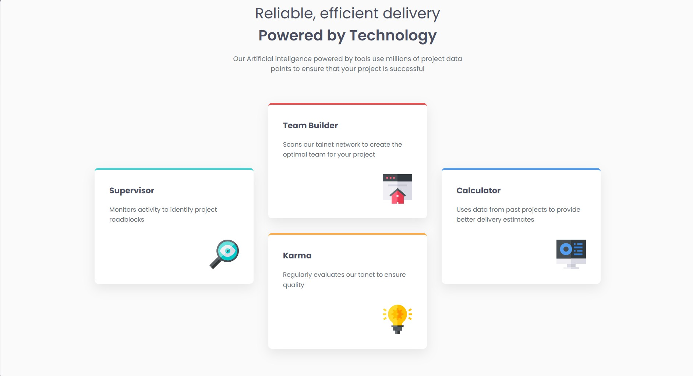

# Frontend Mentor - Four Card Feature Section

This is my solution to the [Four Card Feature Section challenge on Frontend Mentor](https://www.frontendmentor.io/challenges/four-card-feature-section-weK1eFYK).

## Table of Contents

- [Overview](#overview)
  - [The Challenge](#the-challenge)
  - [Screenshot](#screenshot)
  - [Links](#links)
- [My Process](#my-process)
  - [Built With](#built-with)
  - [What I Learned](#what-i-learned)
  - [Continued Development](#continued-development)
- [Author](#author)

## Overview

### The Challenge

Users should be able to:

- View the optimal layout depending on their device's screen size.
- See four feature cards with different colored top borders.
- Read the descriptions and view the icons for each feature.
- Experience a clean and responsive layout on desktop and mobile devices.

### Screenshot



> Add a screenshot of your completed project to the root folder and name it `screenshot.jpg`. Update the image path above if your screenshot has a different filename.

### Links

- **Live Site URL:**[text](https://four-card-feature-section-master1234.netlify.app/)

## My Process

### Built With

- Semantic HTML5
- CSS3
- CSS Grid
- Flexbox
- CSS Media Queries
- Google Fonts
- Responsive design

### What I Learned

While building this project, I practiced:

- Structuring a webpage with semantic HTML.
- Creating a three-column layout using CSS Grid.
- Using Flexbox to stack cards vertically.
- Aligning elements and controlling spacing with `gap`, `padding`, and `margin`.
- Styling cards with colored borders, rounded corners, and box shadows.
- Using media queries to adapt the layout for smaller screens.
- Loading and applying Google Fonts.

One technique I learned was using CSS Grid to create three equal-width columns:

```css
.features {
    display: grid;
    grid-template-columns: repeat(3, minmax(0, 1fr));
    gap: 2rem;
    align-items: center;
}
```

I also learned how to stack the two middle cards using Flexbox:

```css
.feature-middle {
    display: flex;
    flex-direction: column;
    gap: 2rem;
}
```

### Continued Development

In future projects, I want to improve my skills in:

- CSS Grid and Flexbox layouts.
- Responsive and mobile-first design.
- CSS positioning and spacing.
- Writing clean and reusable CSS.
- Building frontend projects independently.

## Author

- Frontend Mentor: [Add your profile link here](https://www.frontendmentor.io/)

