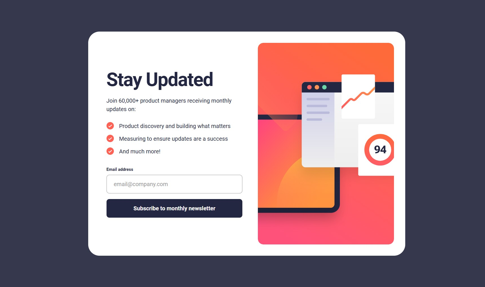

# Frontend Mentor - Newsletter Sign-up Form with Success Message

This is my solution to the [Newsletter Sign-up Form with Success Message challenge](https://www.frontendmentor.io/challenges/newsletter-signup-form-with-success-message-3FC1AZbNrv) on Frontend Mentor.

## Table of Contents

- [Overview](#overview)
  - [The Challenge](#the-challenge)
  - [Screenshot](#screenshot)
  - [Links](#links)
- [My Process](#my-process)
  - [Built With](#built-with)
  - [What I Learned](#what-i-learned)
  - [Continued Development](#continued-development)
  - [Useful Resources](#useful-resources)
  - [AI Collaboration](#ai-collaboration)

## Overview

### The Challenge

Users should be able to:

- Enter their email address and submit the form.
- See a success message displaying their submitted email address.
- See validation messages when the email field is empty or the email address is invalid.
- View a responsive layout on different screen sizes.
- See hover and focus states for interactive elements.
- Dismiss the success message and return to the sign-up form.

### Screenshot



*Replace `screenshot.jpg` with your actual screenshot filename, or add your screenshot to the project root.*

### Links

- Solution URL: Add your Frontend Mentor solution link here.
- Live Site URL: Add your deployed website link here.

## My Process

### Built With

- Semantic HTML5
- CSS custom properties (variables)
- Flexbox
- Responsive design using media queries
- CSS functions: `clamp()`, `min()`, and `min-height`
- Custom fonts using `@font-face`
- JavaScript DOM manipulation
- JavaScript event listeners
- HTML email validation
- CSS pseudo-elements
- Mobile-responsive layouts

### What I Learned

While building this project, I improved my understanding of responsive layouts, form handling, CSS styling, and JavaScript DOM manipulation.

**1. Creating a responsive layout with Flexbox**

I used Flexbox to divide the newsletter card into two sections: the text and form on one side, and the illustration on the other.

```css
.container {
    display: flex;
    align-items: stretch;
    gap: 24px;
}

.info,
.image-about {
    flex: 1;
    min-width: 0;
}
```

**2. Using CSS custom properties**

I learned how to define reusable color variables to keep my stylesheet consistent and easier to maintain.

```css
:root {
    --Red: hsl(4, 100%, 67%);
    --Blue-800: hsl(234, 29%, 20%);
    --Blue-700: hsl(235, 18%, 26%);
    --Grey: hsl(0, 0%, 58%);
    --White: hsl(0, 0%, 100%);
}
```

**3. Making elements responsive with `clamp()`**

I used `clamp()` to make font sizes and spacing adjust according to the viewport size while maintaining minimum and maximum limits.

```css
.info h1 {
    font-size: clamp(2rem, 3.5vw, 3.5rem);
}
```

**4. Replacing default list bullets with images**

I learned how to use the `::before` pseudo-element to display a custom checkmark icon before each list item.

```css
li::before {
    content: "";
    position: absolute;
    left: 0;
    width: 21px;
    height: 21px;
    background-image: url("./assets/images/icon-list.svg");
    background-size: contain;
    background-repeat: no-repeat;
}
```

**5. Handling form submission with JavaScript**

I used event listeners to handle form submission, validate email input, and display the success message without reloading the page.

```javascript
form.addEventListener("submit", function (event) {
    event.preventDefault();

    const email = emailInput.value.trim();

    if (email === "" || !emailInput.checkValidity()) {
        emailError.textContent = "Valid email required";
        emailInput.classList.add("error");
        return;
    }

    submittedEmail.textContent = email;
    container.hidden = true;
    successMessage.hidden = false;
});
```

**6. Switching between the sign-up form and success message**

I learned how to use the `hidden` property to switch between two sections based on user interaction.

```javascript
container.hidden = true;
successMessage.hidden = false;
```

### Continued Development

In future projects, I want to focus on:

- Improving my ability to build responsive layouts independently.
- Writing cleaner and more maintainable CSS.
- Becoming more confident with JavaScript DOM manipulation and event handling.
- Learning more about accessibility and keyboard navigation.
- Building more interactive websites using HTML, CSS, and JavaScript.
- Learning backend development and APIs to build full-stack applications.

### Useful Resources

- [Frontend Mentor](https://www.frontendmentor.io/) - Helped me practise building realistic frontend projects.
- [MDN Web Docs](https://developer.mozilla.org/) - Useful documentation for HTML, CSS, and JavaScript.
- [CSS-Tricks: A Complete Guide to Flexbox](https://css-tricks.com/snippets/css/a-guide-to-flexbox/) - Helped me understand Flexbox layouts.
- [The Markdown Guide](https://www.markdownguide.org/) - Useful for writing and formatting this README.

### AI Collaboration

I used ChatGPT as a learning assistant during this project.

- Used it to understand HTML structure and semantic elements.
- Learned how to use CSS Flexbox, responsive sizing, and custom properties.
- Worked through replacing list bullets with custom image icons.
- Used guidance to implement JavaScript form validation and the success message.
- Debugged layout issues and improved the responsive design.

I used these explanations to understand the implementation and make changes to my own code.
