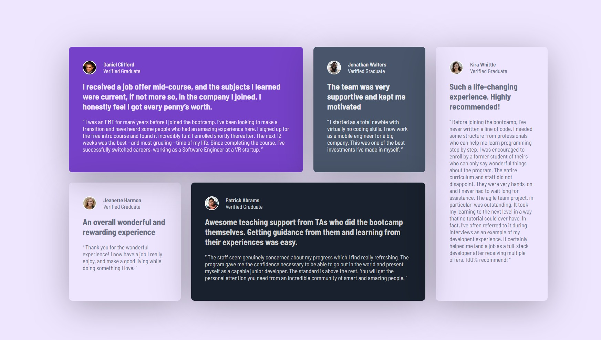

# Frontend Mentor - Testimonials Grid Section

This is my solution to the [Testimonials Grid Section challenge on Frontend Mentor](https://www.frontendmentor.io/challenges/testimonials-grid-section-Nnw6J7Un7).

## Table of Contents

- [Overview](#overview)
  - [The Challenge](#the-challenge)
  - [Screenshot](#screenshot)
  - [Live Demo](#live-demo)
- [My Process](#my-process)
  - [Built With](#built-with)
  - [What I Learned](#what-i-learned)
  - [Challenges Faced](#challenges-faced)
  - [Future Improvements](#future-improvements)
- [Author](#author)

## Overview

### The Challenge

The goal was to build a responsive testimonials grid section that closely matches the provided Frontend Mentor design.

Users should be able to:
- View the optimal layout depending on their device's screen size.
- Read testimonials in a clean and visually appealing layout.
- Experience a consistent design across desktop, tablet, and mobile devices.

### Screenshot



> Replace `screenshot.jpg` with your actual screenshot filename, or add a screenshot with this name to your project folder.

### Live Demo

- **Live Site:** Add your deployed project URL here.
- **Solution Repository:** Add your GitHub repository URL here.

## My Process

### Built With

- Semantic HTML5
- CSS3
- CSS custom properties (variables)
- CSS Grid
- Flexbox
- Responsive design using media queries
- Google Fonts — Barlow Semi Condensed

### What I Learned

While building this project, I improved my understanding of CSS Grid, responsive layouts, CSS custom properties, and positioning.

**1. CSS Grid layout**

I learned how to position cards across multiple columns and rows using `grid-column` and `grid-row`.

```css
.container {
    display: grid;
    grid-template-columns: repeat(4, minmax(0, 1fr));
    gap: var(--card-gap);
}

.daniel {
    grid-column: 1 / 3;
    grid-row: 1;
}

.kira {
    grid-column: 4 / 5;
    grid-row: 1 / 3;
}
```

**2. Responsive design**

I used media queries to adjust the grid for tablet and mobile screens.

```css
@media (max-width: 600px) {
    .container {
        grid-template-columns: 1fr;
    }

    .card {
        grid-column: auto;
        grid-row: auto;
    }
}
```

**3. CSS custom properties**

I used CSS variables to maintain consistent colors, spacing, and border radii throughout the project.

```css
:root {
    --card-gap: 1.5rem;
    --purple-50: hsl(260, 100%, 95%);
    --purple-500: hsl(263, 55%, 52%);
    --card-radius: 0.5rem;
}
```

**4. Creating a solid 3D-style card effect**

I experimented with pseudo-elements to create a separate backing layer behind a card, giving it a raised appearance without relying on a blurred shadow.

```css
.card {
    position: relative;
    isolation: isolate;
    background: white;
    border-radius: 8px;
}

.card::before {
    content: "";
    position: absolute;
    inset: 0;
    background: #d1d1d1;
    border-radius: inherit;
    transform: translate(8px, 8px);
    z-index: -1;
}
```

### Challenges Faced

- Positioning testimonial cards correctly using CSS Grid.
- Understanding how `grid-column` and `grid-row` affect element placement.
- Making the layout responsive without breaking the desktop design.
- Debugging media queries and CSS syntax errors.
- Experimenting with pseudo-elements to create a solid, raised card effect.

Working through these issues helped me understand how CSS properties interact and how to debug layout problems more systematically.

### Future Improvements

- Refine the layout across more screen sizes.
- Improve accessibility with more descriptive image alt text.
- Continue practicing CSS Grid, Flexbox, and pseudo-elements.
- Build more Frontend Mentor projects to improve my frontend development skills.

## Author

- **Frontend Mentor:** [Add your Frontend Mentor profile](https://www.frontendmentor.io/)
- **GitHub:** [Add your GitHub profile](https://github.com/)

